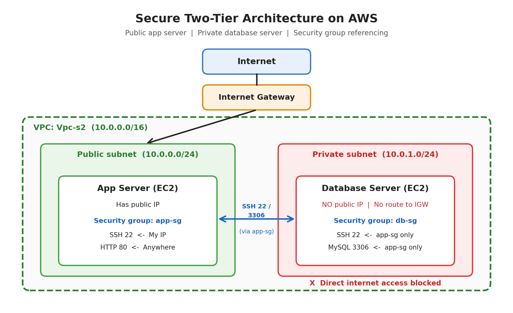

# Secure Two-Tier Architecture on AWS

## Problem
A database server must not be reachable from the internet. Only the app server should be able to connect to it.

## Architecture

## What I built
- Custom VPC with a public subnet and a private subnet
- Internet Gateway and route tables (private subnet has no internet route)
- App server in the public subnet, database server in the private subnet with no public IP
- Security group referencing: the database accepts traffic only from the app server's security group
- App server used as a bastion host to SSH into the database server

## Security group rules

| Group | Type | Port | Source |
|---|---|---|---|
| app-sg | SSH | 22 | My IP |
| app-sg | HTTP | 80 | Anywhere |
| db-sg | SSH | 22 | app-sg |
| db-sg | Custom TCP | 3306 | app-sg |

## Testing
- Database has no public IP
- 
- App server can reach the database on port 3306
- 

- When the db-sg rule was changed, the connection timed out, which proves the security group does the protecting
- 

## What I learned
- How public and private subnets differ
- How route tables and an Internet Gateway work
- How security group referencing works
- How to reach a private server through a bastion host

## Tools
AWS (VPC, EC2, Security Groups), Linux, SSH
